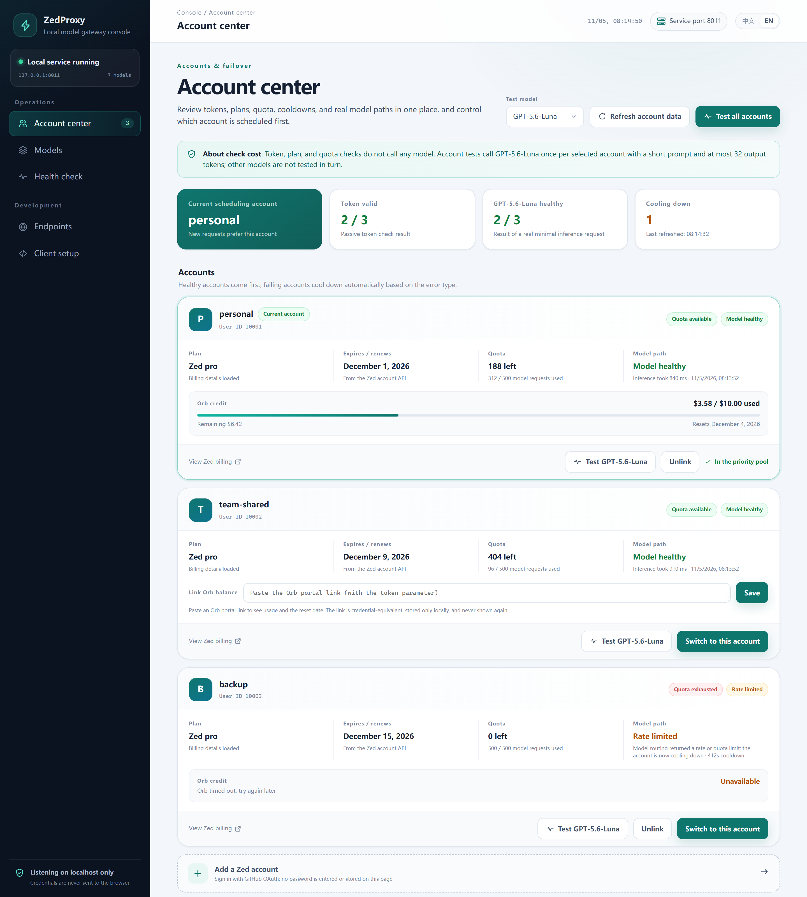
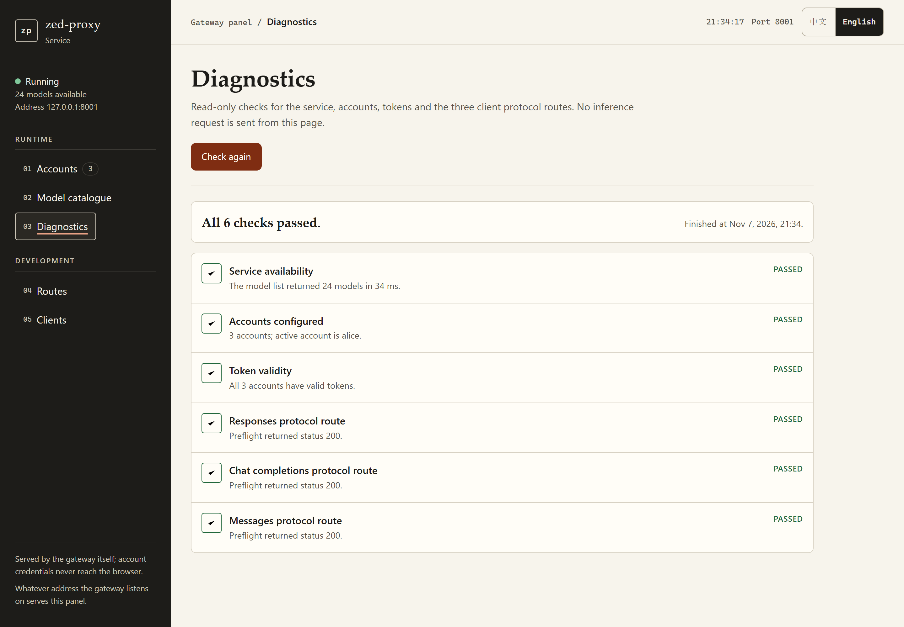

<div align="center">


# ZedProxy

**Use Zed-hosted models, including Gemini 4, from any OpenAI, Anthropic or Codex client.**

<a href="README.zh-CN.md">简体中文</a> | English

[](https://github.com/wray-lee/zed-proxy/actions/workflows/ci.yml)
[](https://github.com/wray-lee/zed-proxy/releases)
[](https://github.com/wray-lee/zed-proxy/pkgs/container/zed-proxy)
[](https://ziglang.org)
[](LICENSE)

<a href="#quick-start">Quick start</a> · <a href="#documentation">Documentation</a> · <a href="docs/architecture.md">Architecture</a> · <a href="CONTRIBUTING.md">Contributing</a>



<sub>Account center: quota, cooldown and live model checks per account.</sub>

</div>

ZedProxy is an HTTP gateway that exposes the models Zed hosts (including `gemini-4-argon`) through the OpenAI Chat Completions, OpenAI Responses, and Anthropic Messages request formats.

Zed's model service expects its own request payloads and a signed-in Zed account. ZedProxy accepts the API shapes that coding clients already speak, converts each request to Zed's format, forwards it to `cloud.zed.dev` with an account credential from its pool, and converts the response back. Clients such as OmniRoute, Codex, and Claude Code can then use Zed-hosted models through their normal OpenAI or Anthropic configuration.

> Unofficial project, not affiliated with or endorsed by Zed Industries. See [Terms and risk](docs/terms-risk.md).

## Features

- OpenAI Chat Completions (`POST /v1/chat/completions`), streaming and non-streaming.
- OpenAI Responses (`POST /v1/responses`), streaming and non-streaming. This route does not carry Gemini models.
- Anthropic Messages (`POST /v1/messages`), streaming and non-streaming.
- Gemini thinking support: client `reasoning_effort` maps to Gemini `thinkingLevel`, and upstream parts marked `thought: true` are split into thinking output instead of visible text.
- Account pool with cooldowns and failover. Auth errors, rate limits, and repeated upstream errors bench an account for a period, and the next request is attempted on another account.
- Web management page served at `/`.
- Credit balance display: attach an Orb portal link to an account and see used and remaining credit, the reset date and a usage bar in the account center.
- Selectable live-check model: probe every account with any model from the catalogue, and the account center remembers the choice.
- Gateway API key authentication with a fail-closed bind rule: a non-loopback bind without any configured key refuses to start.
- Prebuilt multi-arch image on GHCR, plus compose files for the prebuilt image and for building from source.
- Paste-callback login for container and remote deployments.
- `/health` liveness endpoint.

## Web UI

The management page at `/` shows every account's plan, quota, Orb credit balance, cooldown and a live model check, lists the model catalogue with each model's reasoning levels, and has a read-only service diagnosis. It is available in English and Chinese.

<p align="center"></p>

## Quick start

```sh
cp .env.example .env          # then set ZED_API_KEY to your own value
docker compose up -d          # pulls ghcr.io/wray-lee/zed-proxy
curl -s http://127.0.0.1:8001/health
```

1. **Add a Zed account.** Open `http://127.0.0.1:8001/` and use the login button, or see [Login](docs/login.md) for the paste-callback flow used in containers.
2. **Point a client at it.** Use `http://127.0.0.1:8001/v1` as the base URL and your `ZED_API_KEY` as the key.

```sh
curl http://127.0.0.1:8001/v1/chat/completions   -H "Authorization: Bearer $ZED_API_KEY" -H "Content-Type: application/json"   -d '{"model":"gpt-5.6","messages":[{"role":"user","content":"Hello"}]}'
```

`docker-compose.yml` runs the prebuilt `linux/amd64` and `linux/arm64` image from GHCR. To build from this checkout instead, run `docker compose -f docker-compose.build.yml up -d --build`. Both publish only `127.0.0.1:8001` and keep data in `./data`; on Linux run `chown -R 10001:10001 ./data` first.

## Supported protocols

| Client format | Route |
| --- | --- |
| OpenAI Chat Completions | `POST /v1/chat/completions` |
| OpenAI Responses (no Gemini) | `POST /v1/responses` |
| Anthropic Messages | `POST /v1/messages` |

Streaming and non-streaming are supported on all three. Models come from Zed's catalogue, including `gpt-5.6`, `claude-sonnet-5` and `gemini-4-argon`; the full route list is in [API endpoints](docs/api.md).

## Documentation

| Page | What it covers |
| --- | --- |
| [Authentication](docs/authentication.md) | Gateway keys, protected paths, bind policy |
| [Login](docs/login.md) | Adding Zed accounts: paste callback, command line, local callback |
| [Client setup](docs/clients.md) | OmniRoute, Claude Code and other clients |
| [API endpoints](docs/api.md) | Every route and its gateway-key requirement |
| [Configuration](docs/configuration.md) | Environment variables and data files |
| [Architecture](docs/architecture.md) | Modules, request flow, login flow |
| [Known limitations](docs/limitations.md) | What to expect and what is not verified |
| [Terms and risk](docs/terms-risk.md) | Unofficial status and Zed's Terms of Service |
| [Development](docs/development.md) | Building and testing from source |

## Acknowledgements

- [csmsqj/zed-api](https://github.com/csmsqj/zed-api) is the base this project was derived from. It is MIT licensed, and its copyright notice is retained in [LICENSE](LICENSE).

## License

MIT, see [LICENSE](LICENSE). The original copyright belongs to csmsqj; modifications are copyright 2026 wray-lee. Contributions are welcome, see [CONTRIBUTING.md](CONTRIBUTING.md); security reports go through [SECURITY.md](SECURITY.md).
