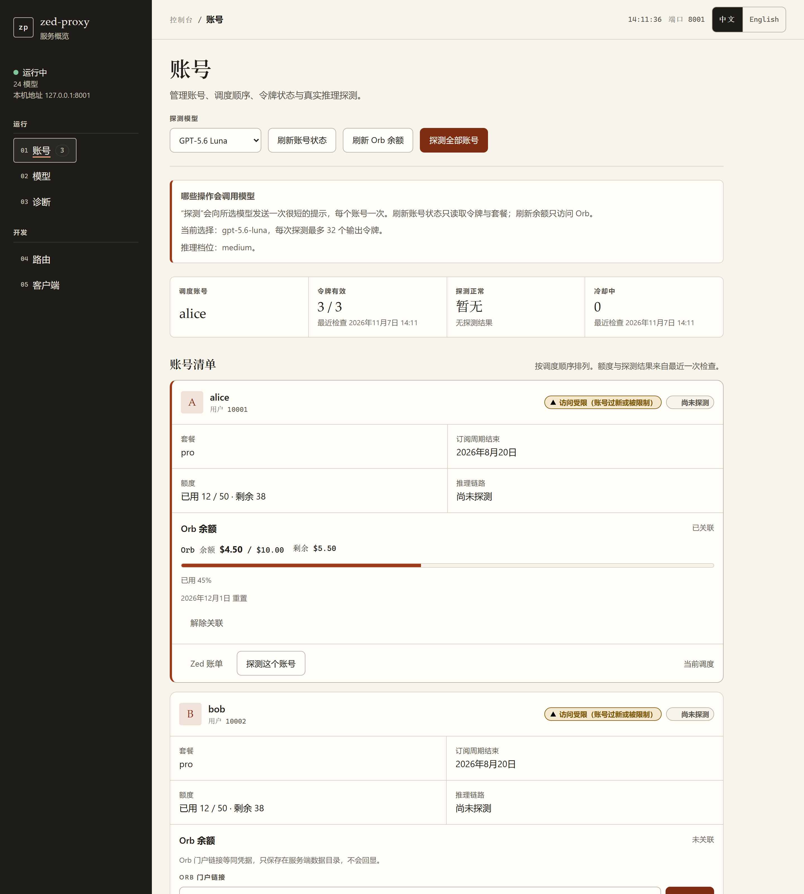
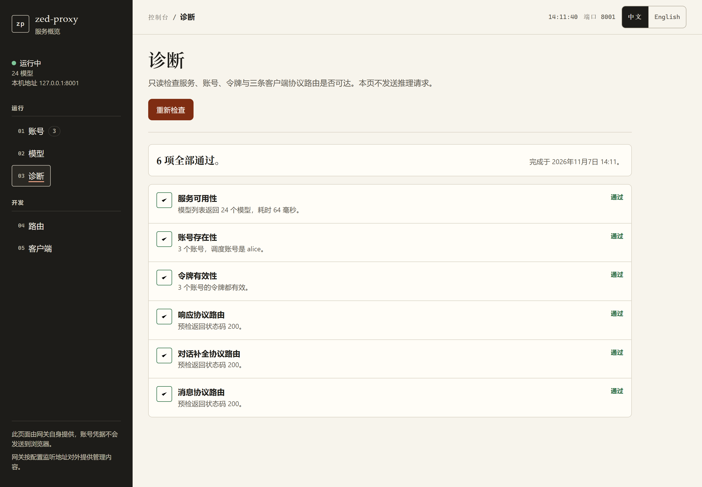

<div align="center">


# ZedProxy

**让任何 OpenAI、Anthropic、Codex 客户端使用 Zed 托管的模型，包括 Gemini 4。**

简体中文 | <a href="README.md">English</a>

[](https://github.com/wray-lee/zed-proxy/actions/workflows/ci.yml)
[](https://github.com/wray-lee/zed-proxy/releases)
[](https://github.com/wray-lee/zed-proxy/pkgs/container/zed-proxy)
[](https://www.rust-lang.org)
[](LICENSE)

<a href="#快速开始">快速开始</a> · <a href="#文档">文档</a> · <a href="docs/architecture.zh-CN.md">架构</a> · <a href="CONTRIBUTING.md">贡献指南</a>



<sub>账号页：调度顺序、令牌与套餐状态、Orb 余额，以及逐账号的真实模型探测。</sub>

</div>

ZedProxy 是一个 HTTP 网关，用 OpenAI Chat Completions、OpenAI Responses 和 Anthropic Messages 三种请求格式访问 Zed 托管的模型（包括 `gemini-4-argon`）。

Zed 的模型服务只接受它自己的请求结构，并要求一个已登录的 Zed 账号。ZedProxy 接受各编程客户端已经在用的 API 形状，由对应 provider 的编码器把请求转换成 Zed 的格式，用账号池里的凭据转发到 `cloud.zed.dev`，再把响应转换回来。这样 OmniRoute、Codex、Claude Code 等客户端就能通过各自习惯的 OpenAI 或 Anthropic 配置使用 Zed 托管的模型。

这是 0.3.0 的 Rust 实现。它以单个静态二进制运行：HTTP、TLS、流式与 RSA 登录全在进程内完成，不启动 `curl` 或 `openssl` 子进程。仅支持 Linux 与容器。

> 非官方项目，与 Zed Industries 无关联，也未获其认可。见[条款与风险](docs/terms-risk.zh-CN.md)。

## 功能

- OpenAI Chat Completions（`POST /v1/chat/completions`），支持流式与非流式。
- OpenAI Responses（`POST /v1/responses`），支持流式与非流式。
- Anthropic Messages（`POST /v1/messages`），支持流式与非流式。
- 三条路由都能到达三家上游 provider（OpenAI、Anthropic 与 Google 模型）。三家 provider 是同一套中立请求/响应类型背后的独立模块，分发依据 Zed 模型目录里声明的 provider。
- Gemini 支持：客户端 `reasoning_effort` 映射到 Gemini `thinkingLevel`，上游 `thought: true` 的 part 拆到思考输出，不混进正文；工具 schema 清洗为 Gemini 子集；工具调用双向往返。
- 账号池、冷却与 failover。鉴权失败、限流、连续瞬时上游错误会让账号进入冷却，下一次请求改试其它账号。
- 请求级失败（上游 `400`/`404`/`413`/`415`/`422`，含 `status.failed` 包装）按 `400` 原样返回上游消息，不重试、不冷却、不故障转移。
- `/` 提供 Web 控制台，中英双语，五个页面：账号、模型、诊断、路由、客户端。
- 余额显示：给账号关联 Orb portal 链接后，账号页显示已用与剩余额度、重置日期和用量进度条，并提供「刷新 Orb 余额」按钮。
- 模型目录页列出每个模型的推理档位与上下文长度，并提供「刷新目录」按钮，按需从 Zed 重新拉取目录。
- 可选探测模型：可用目录中的任意模型探测账号，账号页会记住所选模型。
- 网关 API key 鉴权，绑定策略 fail-closed：非回环地址且未配置任何 key 时拒绝启动。
- GHCR 多架构预构建镜像，以及预构建镜像与源码构建两份 compose 文件。
- 容器/远程部署可用的粘贴回调登录，宿主机可用 `login` 命令。
- `/health` 存活探针，以及供容器编排使用的 `healthcheck` 子命令。
- Rust 工具链：每种架构一个静态 musl 二进制，Web UI 在编译期嵌入。

## Web UI

根路径 `/` 的控制台由网关自身提供。左侧栏常驻服务状态（运行中与否、模型数量、监听地址）与导航，右侧一次显示五个页面之一：

- **账号**：按调度顺序排列的账号清单，逐账号显示套餐、额度、Orb 余额与最近一次探测结果。清单上方是探测模型选择器与三个按钮：「刷新账号状态」只重读令牌与套餐、不调用模型，「刷新 Orb 余额」只访问 Orb，「探测全部账号」对每个账号各发一次很短的推理请求。页头下方的横幅写明探测使用哪个模型、最多多少输出令牌。
- **模型**：网关转发的全部模型及各自的供应商、默认与支持的推理档位、上下文长度。「刷新目录」按需从 Zed 重新拉取；「选用为探测模型」决定账号页探测使用哪个模型。
- **诊断**：固定顺序的六项只读检查（服务、账号、令牌有效性，以及三条协议路由），页面打开即执行，逐项显示通过与失败，并给出完成时刻。
- **路由**：网关对外提供的全部路由，分组列出方法、路径与是否需要网关密钥。本页不发请求。
- **客户端**：Codex、Claude Code、OpenCode 与命令行四条可复制的接入片段，基础地址取自你当前访问页面的地址，密钥是占位符，模型来自目录。

五个页面都有中英两种语言，顶栏切换语言时停留在当前页。每个数据视图都有空态、加载态与错误态；刷新失败时保留屏幕上已有的数值；某一页出错不影响其他页面。

<p align="center"></p>

<p align="center"><sub>诊断页：六项只读检查，不发送推理请求。</sub></p>

## 快速开始

```sh
cp .env.example .env          # 然后把 ZED_API_KEY 改成自己的值
docker compose up -d          # 拉取 ghcr.io/wray-lee/zed-proxy
curl -s http://127.0.0.1:8001/health
```

1. **添加 Zed 账号。** 打开 `http://127.0.0.1:8001/` 点登录按钮；容器内使用的粘贴回调流程见[登录](docs/login.zh-CN.md)。
2. **让客户端指向它。** Base URL 用 `http://127.0.0.1:8001/v1`，key 用你的 `ZED_API_KEY`。

```sh
curl http://127.0.0.1:8001/v1/chat/completions   -H "Authorization: Bearer $ZED_API_KEY" -H "Content-Type: application/json"   -d '{"model":"gpt-5.6","messages":[{"role":"user","content":"你好"}]}'
```

`docker-compose.yml` 直接运行 GHCR 上 `linux/amd64`、`linux/arm64` 的预构建镜像。要从当前目录构建，用 `docker compose -f docker-compose.build.yml up -d --build`。两份都只发布 `127.0.0.1:8001`，数据落在 `./data`；Linux 上先执行 `chown -R 10001:10001 ./data`。

直接构建二进制需要 Rust 1.99 与 Node.js 22（用于内嵌 Web UI）：

```sh
cd webui && npm ci && npm run build && cd ..
cargo build --release          # target/release/zed-proxy
```

二进制会嵌入 `webui/dist/index.html`，所以必须先构建 Web UI；该文件缺失时 `build.rs` 会让构建失败并给出明确提示。`cargo fmt`、`clippy`、`test` 与 musl 镜像见[开发](docs/development.zh-CN.md)。

## 支持的协议

| 客户端格式 | 路由 |
| --- | --- |
| OpenAI Chat Completions | `POST /v1/chat/completions` |
| OpenAI Responses | `POST /v1/responses` |
| Anthropic Messages | `POST /v1/messages` |

三者都支持流式与非流式，且每条路由都能路由到所有 provider。模型来自 Zed 的目录，全部原样提供（GPT、Claude、Gemini 系列）；完整路由见 [API 端点](docs/api.zh-CN.md)。

## 文档

| 页面 | 内容 |
| --- | --- |
| [鉴权](docs/authentication.zh-CN.md) | 网关 key、受保护路径、绑定策略 |
| [登录](docs/login.zh-CN.md) | 添加 Zed 账号：粘贴回调、命令行、本地回调 |
| [客户端配置](docs/clients.zh-CN.md) | OmniRoute、Claude Code 及其他客户端 |
| [API 端点](docs/api.zh-CN.md) | 全部路由及是否需要网关 key |
| [配置](docs/configuration.zh-CN.md) | 环境变量、命令行与数据文件 |
| [架构](docs/architecture.zh-CN.md) | 模块、请求流、登录流、分层 |
| [已知限制](docs/limitations.zh-CN.md) | 预期行为与未验证项 |
| [条款与风险](docs/terms-risk.zh-CN.md) | 非官方声明与 Zed 服务条款 |
| [开发](docs/development.zh-CN.md) | 从源码构建与测试 |
| [控制台（WebUI）](docs/webui.zh-CN.md) | 控制台的文件、设计规则与行为 |

## 致谢

- [csmsqj/zed-api](https://github.com/csmsqj/zed-api) 是本项目的基础。该项目为 MIT 许可，其版权声明保留在 [LICENSE](LICENSE) 中。

## 许可证

MIT，见 [LICENSE](LICENSE)。原始版权归 csmsqj；修改部分版权 2026 wray-lee。欢迎贡献，见 [CONTRIBUTING.md](CONTRIBUTING.md)；安全问题按 [SECURITY.md](SECURITY.md) 报告。
